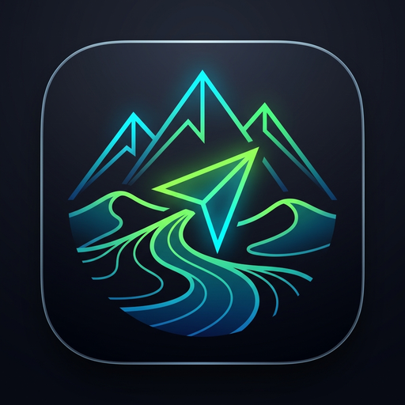

# 🧭 山海行 (TerraWay) - 全地形户外手持 GPS 导航与多点路书系统

  

  <b>100% 纯脱网运行 · 北斗/GPS双模遥测 · 全景交互地图 · 经典罗盘指针 · 沿线走廊离线下载</b> 
  <i>为重装徒步、山地骑行、硬派越野、戈壁探险与无人区穿越量身打造的专业级数字手持机</i>

  
  
  
  
  

---

## 📥 最新正式安装包下载 (Releases)

您可以通过以下渠道直接下载最新正式版 Android 安装包（即装即用，支持主流华为、小米、OPPO、vivo、荣耀、三星及各类三防手持机终端）：

- 🚀 **GitHub Releases 官方极速下载**：[点击前往 Releases 下载最新 APK 安装包](https://github.com/qingmi2001/terraway-app/releases)
  - 正式包名称：`山海行_全地形手持离线导航_v0.7.8.apk`
  - 核心架构：ARM64-v8a / armeabi-v7a 通用自适应包
- 🌐 **Cloudflare Pages 全球 CDN 官网下载**：通过我们的官方发布站获取最新安装镜像与路线图集；
- ☁️ **云盘官方网盘归档备份**：进入官方发布目录直接获取全套路线数据集与历史镜像。

---

## 🌟 核心九大硬核优势 (v0.7.8 重磅升级)

### 1. 🗺️ 首页全景地图模式与右下角悬浮按钮单手快切
- **开机即地图**：默认进入全景交互式离线地图，支持单指平滑拖拽、双指捏合缩放与双击放大；
- **右下角战术悬浮胶囊 (FAB)**：在【🗺️ 全景地图 ⇋ 🧭 指针罗盘】之间毫秒级平滑翻转切换；
- **极端恶劣能见度盲走**：一键切入罗盘模式，超大车头航向盘、实时车速、高程海拔与下一航点夹角（Bearing）尽收眼底，专为大雾、风雪、沙漠黑夜盲走冲点设计。

### 2. ⚡ 动静结合切片缓存与路线沿线走廊一键下载
- **自定位实时动态缓存**：在有蜂窝或 Wi-Fi 信号时，随着自身移动自适应加载地图切片，并自动写入手机本地存储（`/offline_tiles/`）。进入无人区后直接读取本地磁盘缓存，100% 离线脱网秒级出图；
- **路线沿线走廊预下载**：查看路书时点击【📥 缓存沿线地图】，系统自动计算路书外接矩形两翼 5 公里安全走廊切片范围，多线程批量抓取预载至手机；
- **三大多模态图层热切换**：内置户外等高线地形图 (OpenTopoMap)、高清晰卫星影像 (ArcGIS Satellite) 与标准道路 (OSM) 实时切换；
- **脱网极端网格保底**：在未下载且完全脱网环境下，自动激活战术经纬度网格与坐标十字星，航迹与路书依然高精叠加渲染。

### 3. 🛰️ 基站秒开粗定位 ➔ 物理卫星高精无缝接管 (A-GPS / Fused)
- **0 秒极速展图**：开机优先读取系统最后已知位置毫秒级展图，彻底消除开机纯 GPS 广播星历慢速下载等待；
- **基站光圈过渡**：基站/网络粗定位到达时，在自定位外围渲染半透明淡蓝色精度范围圈（Accuracy Circle）；卫星芯片完成 4 星以上锁定后，光圈自动平滑收缩为 3 米高精度绿色中心点，车头航向箭头平滑对齐当前行车方向。

### 4. 🏞️ 全国 62 条经典越野、徒步与全地形自驾官方基准路书
- 官方内置覆盖**内蒙古 (8条)、新疆 (12条)、西藏 (12条)、川西/西南 (10条)、青海/甘肃 (8条)、华北/东北 (6条)、华东/华南 (6条)**共 62 条国家级户外路线；
- 真实经纬度坐标、关键补给点、地形地貌、车辆要求与海拔落差，支持离线脱网克隆与直观领航。

### 5. 🔒 路线三维独立物理隔离架构
- **维度一：公共精选路线**：经审核面向全网开放，支持大区、地貌、场景、难度、车型多维检索；
- **维度二：团队发布协助**：基于 6 位专属救援/巡护协同短码，支持生命周期与过期时效管理，免密快速协同分发；
- **维度三：个人私有备份**：私密专属云端加密存储，仅个人可见，数据严格物理隔离。

### 6. 🚶 无导航自由盲走录制与智能路书萃取
- 无需预设路书，随时一键自由漫步开启高精度 GPS 轨迹录制；
- 实时高程中值滤波、驻车死区防漂移与车载罗盘动态融合；
- 盲走轨迹一键转为连续路书，支持按 500m / 1km / 2km 自适应打点，智能保留前后航向角偏差 >35° 的关键拐角。

### 7. 🛡️ 纯脱网 100% 独立生存保障 (Air-Gapped)
- 拔掉 SIM 卡、开启飞行模式或深处无人类信号的无人区荒漠，全部导航、搜星、罗盘、测距与轨迹记录均 100% 正常运行，无广告、无弹窗、不索取与定位无关的敏感权限。

---

## 📋 历次版本演进摘要

详见完整更新日志：[CHANGELOG.md](CHANGELOG.md)

- **v0.7.8 (2026-11-03)**：
  - 首页升级默认全景地图模式，增加右下角战术悬浮按钮（FAB）秒级双模快切；
  - 动态瓦片多级缓存引擎与路书沿线走廊 5km 离线批量预下载；
  - 全国 62 条经典越野/徒步官方基准路书体系上线；
  - 基站/网络粗定位秒级出图与 GNSS 高精接管。
- **v0.7.7 (2026-11-03)**：
  - 路线与路书三维独立体系；基础数据字典解耦引擎；Web 控制台双轨制强健认证。
- **v0.7.6 (2026-11-03)**：
  - 公共路线广场与私有路线物理双库分离；自由盲走录制；转弯识别自适应萃取。

---

## ⚠️ 户外探险安全与免责声明

详见法律声明文件：[DISCLAIMER.md](DISCLAIMER.md)

1. **民用级辅助定位性质**：本软件属于民用级智能终端离线辅助工具，受手机天线性能、电量及气候影响，**严禁作为无人区极端环境生存的唯一依赖**。
2. **强制冗余安全保障**：进入无人区、高海拔雪山或未开发荒野前，**必须携带卫星电话、便携式光学指北针与纸质等高线地图**，并制定周密的向导协同与应急救援备案。
3. **驾驶与安全责任**：用户应独立对实际驾驶决策、通行路线与人身安全负全部责任。

---

## 💬 路线推荐与问题反馈

欢迎越野车友、户外领队与徒步爱好者共同丰富全国路书数据！
- 提交经典路线 GPX 数据：请提交 [Issues](https://github.com/qingmi2001/terraway-app/issues) 并附带轨迹说明；
- 报告 Bug 与体验改进：请在 Issues 中说明手机型号、系统版本与故障现象。
